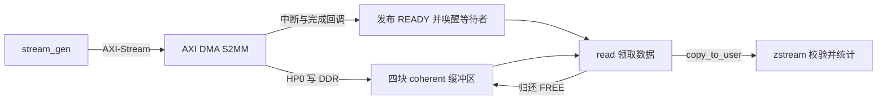

# Zynq AXI DMA 接收学习项目

在正点原子领航者 Zynq-7020 上，完成从 FPGA 数据源到 Linux 用户态的接收链路：控制寄存器、DMAEngine、字符设备、阻塞/非阻塞读取、poll、四缓冲区、停止清理、诊断和性能记录。

当前版本已完成本轮性能对照、一小时以上持续接收、100 次启停、50 次加载卸载，以及运行中卸载保护检查。结论依据用户提供的上板输出，具体参数、原始数据和验证范围见[性能与稳定性记录](docs/week11_性能记录.md)。本 README 和[演示流程](docs/演示流程.md) 根据现有源码与记录整理，尚未从干净环境重新执行整套流程。

## 1. 当前工程与环境

| 项目 | 当前配置 |
|---|---|
| 开发板 | 正点原子领航者 Zynq-7020 |
| Vivado | 2020.2，使用 [Navigator_7020.xpr](Navigator_7020/Navigator_7020.xpr) |
| Linux | `5.4.0-xilinx-v2020.2`，非 PREEMPT_RT 内核 |
| 系统制作路线 | 教程第 20 章：PetaLinux 生成硬件描述，独立内核构建 zImage、DTB 和模块 |
| AXI DMA | S2MM 单向接收，Simple 模式，未启用硬件 SG |
| 数据源 | 32 位 AXI-Stream，100 MHz；每包内容从 0 递增 |
| DMA 缓冲区 | 4 块，每块 16 KiB；实际包长可以更小 |
| 用户程序 | 单线程，默认校验，非阻塞 read 配合 poll |
| 设备节点 | `/dev/zynq_stream0`，收发使用 O_RDWR；O_RDONLY 仅允许查询 |

仓库中的 `zynq_stream_dma/` 是早期最小学习工程，当前上板使用 `Navigator_7020/`。不要混用两套工程的地址或产物。

```text
AXI_DMA/
├─ Navigator_7020/          当前板级 Vivado 工程
│  ├─ rtl/stream_gen.v      FPGA 数据源
│  └─ scripts/finish_dma_gp1.tcl
├─ device-tree/             当前硬件对应的设备树源文件
├─ stream_ctrl.c            驱动实现
├─ stream_ctrl.h            驱动内部状态、寄存器和缓冲区定义
├─ stream_ctrl_uapi.h       驱动与用户态共用的 ioctl、统计和日志格式
├─ zstream.c                用户态读取、校验与性能记录
├─ Makefile                 内核模块构建入口
└─ docs/                    学习记录、问题排查、测试结果与演示流程
```

## 2. 先看懂数据怎么走



`insmod` 只建立设备和资源；START 或 read 按驱动逻辑安排接收。工作队列负责可能睡眠的准备工作，完成回调负责发布状态和接手已预备的下一包。

每块缓冲区的生命周期是：

```text
FREE → PREPARING → PREPARED → IN_FLIGHT → READY → USER_READING → FREE
```

- `PREPARED`：描述符已经提交给 DMA 驱动，FPGA 尚未为这一包启动；描述符归底层管理。
- 流水线允许接收 A 时预备 B，也允许用户读取更早完成的包；同一时刻只有一包由 FPGA 实际发送。
- `poll` 登记等待关系并报告可读/错误状态，真正取数据的是 read；通知次数不等于包数。
- `copy_to_user` 完成后，内核缓冲区即可归还，用户态校验自己的数据副本。
- `io_lock` 串行化读与启停等操作；`state_lock` 保护回调、工作队列与用户操作共享的状态，持有时不能睡眠。
- 正常 STOP 禁止新预备，让已领取的最多两包排空，再统一清理；RESET 和错误路径执行强制终止。只有旧 DMA 和回调不再访问，缓冲区才能复用或释放。

## 3. 硬件、设备树和启动产物要对应

| 设备 | 当前地址/配置 |
|---|---|
| AXI DMA 寄存器 | `0x80400000`，通过 GP1 控制 |
| stream_gen 寄存器 | `0x83CB0000`，通过 GP1 控制 |
| stream_gen 版本 | 偏移 `0x1C`，当前值 `0x00010001` |
| DMA 接收中断 | 设备树 `<0 54 4>` |
| DMA 写内存 | 经 PS 的 HP0 访问 DDR |

[system-user.dtsi](device-tree/system-user.dtsi) 的 DMA 关联是：

```dts
&axi_dma_0 {
    status = "okay";
};

&stream_gen_0 {
    compatible = "zrg,zynq-stream-axidma";
    dmas = <&axi_dma_0 1>;
    dma-names = "rx";
    status = "okay";
};
```

地址、中断和时钟来自新 XSA 生成的 `pl.dtsi`。`system-user.dtsi` 还包含板级网口和启动配置，迁移时不能只复制上面这段来代替整个板级文件。当前使用 NFS 根文件系统：开发板 `192.168.1.10`，主机 `192.168.1.11`，根目录 `/home/zy/workspace/nfs/rootfs`；换环境时需调整。

| 文件 | 作用与对应关系 |
|---|---|
| `BOOT.BIN` | 前期启动镜像；内部包含哪些分区取决于实际打包设置 |
| `boot.scr` | U-Boot 启动脚本；本项目已使用的 zImage 路径会加载独立 `system.bit` |
| `system.bit` | 当前官方工程生成的 `system_wrapper.bit`，部署时改为这个文件名 |
| `system.dtb` | 独立内核生成的 `system-top.dtb`，部署时改为这个文件名 |
| `zImage` | 实际启动的独立构建内核 |
| `stream_ctrl.ko` | 使用该内核对应构建目录编译的外部模块 |

系统构建沿用《领航者 ZYNQ 之嵌入式 Linux 开发指南 V3.3》第 20 章，实际迁移和部署过程见[上板产物不对应排查](docs/week7_上板问题与产物对应排查.md)。仓库保存源码和设备树参考，不包含完整 SDK、内核构建目录或所有生成的启动镜像。

## 4. 编译与最短使用流程

以下以板子已经能用匹配的 bitstream、DTB、内核启动为前提。在 Ubuntu 中先配置原有 ARM SDK/交叉编译环境，确保 `CC` 和内核使用的交叉编译设置可用。

```bash
cd ~/linux/drivers/AXI_DMA
make
$CC zstream.c -o zstream
```

`make` 生成 `stream_ctrl.ko`，默认 KDIR 为 `~/workspace/kernel-driver/linux-xlnx-xlnx_rebase_v5.4_2020.2`。它使用 `ARCH=arm`，不会自动安装或配置工具链。内核目录不同可用 `make KDIR=/实际内核构建目录` 覆盖；必须与板上运行的内核构建相符。

更新虚拟机源码时，一并复制 `stream_ctrl.c`、`stream_ctrl.h`、`stream_ctrl_uapi.h`、`Makefile`；用户程序还需要 `zstream.c` 和同一份 UAPI 头文件。模块和用户程序是分别编译的。

把新 `stream_ctrl.ko` 和 `zstream` 放到板上可访问的同一目录，以 root 运行。以下假设模块尚未加载；已加载时先退出收发程序，再正常卸载旧模块。

```bash
insmod stream_ctrl.ko
./zstream 100 --rate 0 --pkt-len 512
rmmod stream_ctrl
```

读取成功应看到 `success=100 data_error=0 read_error=0 verify=on`，驱动错误、超时为 0。STOP 可能额外完成并丢弃预接收尾包，因此 `driver_rx_packets` 可以略多于用户读取量。

| 改动内容 | 通常需要更新的产物 |
|---|---|
| 驱动或驱动头文件 | 重新 make 并更新 ko |
| zstream 或共用 UAPI | 重新编译用户程序；UAPI 若影响驱动，驱动也要同步编译 |
| RTL 或 BD | 更新 bitstream、XSA，并核对对应的设备树 |
| 设备树 | 更新实际加载的 DTB；按第 20 章已有配置构建 |
| 实际运行内核 | 使用新内核对应构建结果重新编译 ko |

## 5. zstream 只保留这些用法

```text
./zstream [包数] [--pkt-len N] [--rate N] [--blocking] [--no-verify]
./zstream trace
./zstream reset
```

| 参数/命令 | 含义 |
|---|---|
| 包数 | 默认 100，表示用户要读取的完整包数 |
| `--pkt-len N` | 每包 N 个 32 位数，范围 1～4096，默认 16；字节数为 N×4 |
| `--rate N` | 数据拍之间的额外等待周期，0 表示不额外等待；不指定时沿用驱动当前配置，模块初始默认 1000 |
| `--blocking` | 使用阻塞 read；默认使用非阻塞 read，EAGAIN 后通过 poll 等待 |
| `--no-verify` | 关闭内容校验；默认开启，关闭后的 success 只表示读取成功 |
| `trace` | 只读查看已有事件历史，不启动接收，也不清空历史 |
| `reset` | 停止并复位接收、清空和解冻事件历史，不自动开始接收 |

每包数据按小端 32 位数解释，期望为 `0, 1, 2, ...`。`--pkt-len 512` 就是一包 2048 B；它改变实际传输长度，不改变四块 16 KiB 缓冲区的分配容量。

普通接收结束后，结果自动追加到当前目录的 `zstream_results.csv`。`rx_ms` 包含启动、接收和可选校验，`stop_ms` 单独统计；CPU 是整机平均忙碌率，极短测试的百分比不宜用于评价负载。字段定义见[测试记录](docs/week11_性能记录.md)。

Ctrl+C 或 SIGTERM 默认直接结束进程，驱动在最后一个控制句柄关闭时清理并打印统计，该次不会追加用户态性能 CSV。按包数正常结束则执行 STOP、查询、关闭和 CSV 保存。

## 6. 按需开启诊断

`profile` 和 `trace` 是加载时决定的只读模块参数，默认均关闭。先退出应用并卸载模块，再选择加载参数：

```bash
insmod stream_ctrl.ko profile=1 trace=1
./zstream 100 --rate 0 --pkt-len 512
./zstream trace
```

profile 输出各阶段经过时间，可能含等待与抢占，重叠行不能直接相加。trace 保存最近 128 条事件，异常时冻结；`rx_id` 关联软件接收，cookie 关联 DMA 事务。长测后的历史只覆盖尾部，不能当作整场完整记录。诊断会增加开销，正式吞吐数据与默认关闭状态分别记录。

临时故障注入 `test_fault` 已从当前版本移除，旧学习记录中的命令不作为当前入口。现有错误处理实现及 ioctl 定义以 [stream_ctrl.c](stream_ctrl.c) 和 [stream_ctrl_uapi.h](stream_ctrl_uapi.h) 为准。

## 7. 已取得的结果与当前边界

以下每组均为 rate=0、每轮 640 MB、三次平均，profile/trace 关闭，MB 为十进制：

| 每包大小 | 开启校验 MB/s | 关闭校验 MB/s |
|---:|---:|---:|
| 64 B | 5.176 | 5.483 |
| 1024 B | 19.002 | 56.593 |
| 2048 B | 26.549 | 84.648 |

另已完成 rate=100、1000 对照、外部计时一小时以上持续接收、Ctrl+C 后重新读取、100 次启停、50 次加载接收卸载。长测成功读取约 103.633 GB，驱动错误和超时为 0；这是驱动读取统计，不等同于逐包用户态校验完成计数。

关闭手动解绑入口后，已重新编译并上板确认：sysfs 没有 bind/unbind，收发期间 rmmod 被拒绝，应用退出后卸载返回 0。上述具体测试结果的总结置信度为 **99%**；它们不证明硬件吞吐上限或所有并发场景安全。

- 当前只实现接收，不包含 MM2S 发送或 mmap；采用四缓冲区和单 DMA 通道，不支持运行中热移除。
- 本版按静态板载设备使用，sysfs 手动 bind/unbind 已关闭；使用普通 insmod/rmmod，应用退出后再卸载。模块引用计数由内核维护。
- 建议一次只运行一个收发/控制实例；配置和统计是设备共享的，没有独立的每进程接收会话。
- DMA 完成和软件 rx_bytes 均不能独立证明实际完整包长，数据内容校验仍有意义。底层 Simple DMA 的 residue 信息存在限制。
- 依赖当前 Linux 5.4 非 RT 环境的回调同步处理，未采用内核 DMA 补丁；底层未完整上报的硬件停止失败不属于本轮已覆盖的异常场景。
- 不同缓冲区分配容量、ring 深度尚未对照测试；现有结果不向其他板卡、时钟和软件版本直接外推。

## 8. 文档与演示入口

- [演示流程与讲解提纲](docs/演示流程.md)：按当前命令完成接收、校验、性能对照和 RESET 后重新接收。
- [性能与稳定性记录](docs/week11_性能记录.md)：参数、复现命令、24 条正式 CSV 原始数据及稳定性结果。
- [上板产物不对应排查](docs/week7_上板问题与产物对应排查.md)：硬件、bitstream、设备树、内核和模块的对应关系。
- [共用 UAPI](stream_ctrl_uapi.h)：ioctl 命令、统计字段、诊断格式。

docs 下早期周记录保留当时的代码、地址和命令，阅读时按历史材料理解；当前使用入口以本 README 和源码为准。
